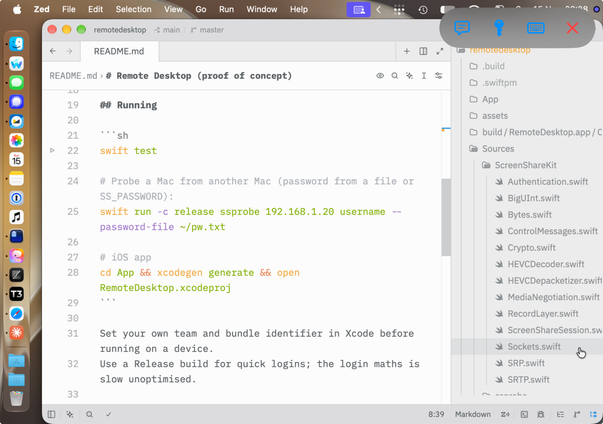
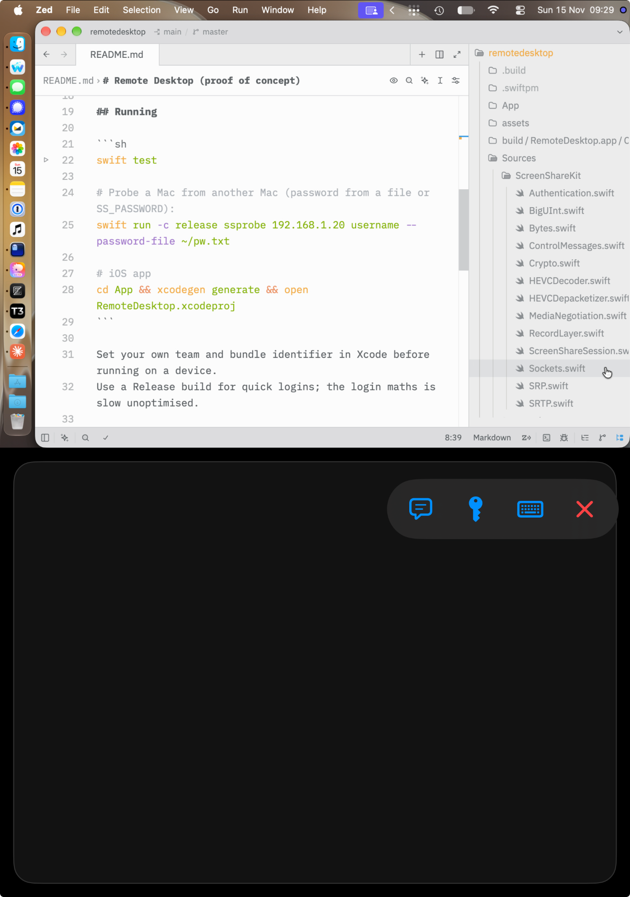

# Remote Desktop (proof of concept)

An iPhone, iPad and Mac client for macOS Screen Sharing's High Performance
mode: HEVC video over SRTP/UDP, negotiated through Apple's extended VNC control
channel. Nothing is installed on the Mac being controlled; it only needs Screen
Sharing turned on (Apple silicon, macOS 14 or later).

The protocol is undocumented by Apple.

Built on the same protocol stack (`ScreenShareKit`), the project also includes:

- **Web gateway** (`ssgateway`) – view and control a Mac from any browser with
  HEVC WebCodecs support, such as Safari on Apple HomeView.
- **HomeKit camera** (`sscamera`) – show a Mac's screen as a camera in the
  Home app, with live view, snapshots and remote viewing.
- **Command-line probe** (`ssprobe`) – connect, log the session and save a
  decoded frame, for testing the protocol stack without the app.
- **Browser probe** (`WebProbe`) – a page that checks which HEVC formats a
  browser can decode, used to choose what the gateway sends.

<p>
  
  
</p>

## Features

**Connecting**

- Macs with Screen Sharing turned on are found on the local network (Bonjour).
- Saved Macs appear as cards showing their screen as it was last seen, most
  recently used first, with a green dot when the Mac is on the network.
- Passwords are optional to save and are kept in the device keychain.
- Sign-in uses SRP, so the password never leaves the device. Accounts the Mac
  holds no SRP verifier for fall back to the older RSA-wrapped password login.

**Display**

- Hardware HEVC decoding, with each frame shown as soon as it arrives.
- Virtual display: the Mac creates a display sized for the device and rendered
  at its pixel density, and resizes it when the device rotates, folds or the
  window changes size. The Mac's own screen is hidden while connected.
- Or mirror the Mac's physical display instead.
- The pointer is drawn locally from the shape the Mac reports, so it follows
  your finger without waiting for video.
- On a folding device held half open, the video takes the upper half and the
  lower half becomes a trackpad.

**Touch input (iPhone and iPad)**

The screen behaves like a trackpad, so your finger never covers what you are
pointing at.

| Gesture | Action |
| --- | --- |
| Slide one finger | Move the pointer |
| Tap | Click |
| Touch and hold, then slide | Drag |
| Two-finger tap | Right click |
| Two-finger slide | Scroll |
| Three-finger swipe up / down | Mission Control / the app's windows |
| Three-finger swipe left / right | Next / previous Space |
| Slide in from the left edge | App switcher; keep sliding to move through apps |
| Two-finger touch and hold | Ring of Copy, Paste, Screenshot and Undo |

**Keyboard and text**

- On-screen keyboard, and hardware keyboards with modifier keys passed through.
- Write Text: compose with the device's own autocorrect and dictation, then
  send it to the Mac in one go, optionally followed by Return.
- Type Password: types the account password at the Mac's lock screen or an
  administrator prompt.

**Mac app**

- Built with Mac Catalyst. The mouse drives the remote pointer directly, the
  keyboard is always connected, and the session actions sit in the window
  toolbar.

## Layout

- `Sources/ScreenShareKit` – the protocol stack: SRP login, encrypted control
  channel, media negotiation, SRTP, HEVC reassembly and VideoToolbox decoding.
- `Sources/ssprobe` – command-line tool that connects to a Mac, prints what
  arrives and saves the first decoded frame as a PNG.
- `Sources/ssgateway` – web gateway: serves a page that views and controls
  the Mac from a browser, for devices the app cannot be installed on.
- `Sources/sscamera` – HomeKit camera: publishes the Mac's screen as an IP
  camera in the Home app.
- `App` – the SwiftUI app for iOS, iPadOS and macOS (Mac Catalyst).
  `App/Tools/make-icon.swift` renders the app icon.
- `WebProbe` – browser capability probe page, its test clips and a small
  server that collects the results.
- `Tests` – unit tests for the protocol stack and the HomeKit accessory
  (`swift test`).
- `assets` – icon source and screenshots.

## Running

Requires Xcode and [XcodeGen](https://github.com/yonaskolb/XcodeGen). The app
targets iOS 17 and later.

```sh
swift test

# Probe a Mac from another Mac (password from a file or SS_PASSWORD):
swift run -c release ssprobe 192.168.1.20 username --password-file ~/pw.txt

# The app
cd App && xcodegen generate && open RemoteDesktop.xcodeproj
```

`ssprobe` options: `--virtual WxH` asks for a virtual display of that size
instead of mirroring, `--bind ip` picks the local address, `--seconds n` sets
how long to stay connected (default 8) and `--frame out.png` where to save the
first frame (default `frame.png`).

Set your own team and bundle identifier in `App/project.yml` (or in Xcode)
before running on a device. Choose the "My Mac (Mac Catalyst)" destination for
the Mac app. Use a Release build for quick logins; the login maths is slow
unoptimised.

## Web gateway

`ssgateway` runs on a Mac on the same network and lets a browser stand in for
the app. It signs in to the Mac being controlled, passes the HEVC video to the
page untouched (the page decodes it with WebCodecs) and relays the page's
pointer and keyboard. It was written for Apple HomeView, whose only route for
third-party code is Safari.

```sh
# Asks for the password if neither --password-file nor SS_PASSWORD is given:
swift run -c release ssgateway 192.168.1.20 username

# No Mac to hand: a moving test picture that echoes pointer and key input.
swift run -c release ssgateway --test-pattern
```

It prints an address such as `http://192.168.1.244:8080/#k7mq2xpd` to open in
the browser. The part after `#` is an access code; a browser without it is
asked to type it. Use `--code` to keep the same code between runs, `--port`
to move off 8080 (the port after it is used too), `--listen` to listen on one
address only, `--mirror` to mirror the physical display and `--verbose` for
the session log and the browser's decoding figures.

- One browser at a time. The session starts when the page connects and ends
  when it closes, so a virtual display only hides the Mac's screen while
  someone is watching.
- Touch works as in the app: slide to move, tap to click, touch and hold then
  slide to drag, two fingers to scroll or right-click, three-finger swipes for
  Mission Control and Spaces. A mouse points directly.
- The Mac's password never reaches the browser, but the page and the video
  travel over plain HTTP: use it on a network you trust.
- The browser needs WebCodecs with HEVC 4:4:4 decoding. Safari 27 on HomeView
  and on macOS has it.
- Like any client, the gateway cannot run on the Mac it controls (see below).

## HomeKit camera

`sscamera` runs on an always-on Mac on the same network and adds the screen of
another Mac to the Home app as a camera, with live view, snapshot tiles and
remote viewing through a home hub. It implements the HomeKit Accessory
Protocol itself (pairing, encrypted sessions, Bonjour, and the Camera RTP
Stream Management service), so it needs no Homebridge or Node. HomeKit only
accepts H.264, so it decodes the Mac's HEVC and re-encodes it with
VideoToolbox at the size, frame rate and bitrate each viewer asks for.

```sh
# Asks for the password if neither --password-file nor SS_PASSWORD is given:
swift run -c release sscamera 192.168.1.20 username

# Running on the Mac whose screen you want (captures it directly):
swift run -c release sscamera --local

# No Mac to hand: a moving test picture with a clock.
swift run -c release sscamera --test-pattern
```

It prints a setup code. In the Home app choose + → Add Accessory → More
options…, pick the camera (it is an uncertified accessory, so confirm "Add
Anyway") and enter the code.

- One Screen Sharing session is shared by every viewer. It starts when someone
  opens the camera or the Home app asks for a snapshot, and ends 30 seconds
  after the last viewer leaves (`--linger`). `--always-on` keeps it connected,
  so live view starts instantly at the cost of a permanent session.
- The physical display is mirrored by default, so nobody at the Mac is
  disturbed. `--virtual-display 1920x1080` streams a virtual display instead,
  which hides the Mac's screen while anyone is watching.
- Some viewers crop the video to fill their screen: a square display shows
  only the middle of the 16:9 stream. `--aspect 1:1` fits the whole screen
  into the centre square of every frame (and snapshot), at the cost of side
  bars on 16:9 viewers such as phones.
- Up to two viewers at once by default (`--streams` for 1 to 4). View only:
  HomeKit has no way to send input. No audio.
- The identity and pairings live in `~/Library/Application Support/sscamera`
  (`--state` to move them). Remove the camera in the Home app, or start with
  `--reset` (a fresh identity and setup code), to pair again. `--setup-code`, `--name` and `--port` (default
  51828) set the rest.
- Screen Sharing cannot connect to the Mac it runs on, so to show the Mac
  `sscamera` runs on, use `--local`. It captures the main display with
  ScreenCaptureKit (allow the terminal under Privacy & Security → Screen &
  System Audio Recording) only while someone is watching, so the recording
  indicator appears just then.
- Showing another Mac uses the Screen Sharing client ports, so it cannot run
  alongside the app or `ssgateway` on the same machine.
- `--verbose` prints the HomeKit and session logs.
- Written from the HomeKit Accessory Protocol specification; tested against an
  independent controller (pairing, snapshot, SRTP stream decode, unpairing).

## Browser probe

`WebProbe` checks what a browser can decode before relying on it: it feeds
short HEVC clips in several pixel formats and profiles to WebCodecs and reports
which ones play, then posts the results back to the server, which saves them
in `WebProbe/reports/`.

```sh
swift WebProbe/make-samples.swift   # regenerate samples.js (optional)
python3 WebProbe/serve.py 8000 0.0.0.0
```

WebCodecs is only available on HTTPS pages, so to test another device put an
HTTPS front end (such as `tailscale funnel`) in front of the server.

## Notes

- The client must be able to bind UDP ports 5900 and 5901 locally, because the
  Mac sends media back to the same port numbers it listens on. A Mac running
  Screen Sharing itself already uses those ports, so test from a different
  machine or a real iPhone/iPad rather than against `localhost`.
- "Use a virtual display" hides the Mac's physical screen for the duration of
  the session; without it the physical display is mirrored.
- Not implemented yet: audio, clipboard sharing between the device and the Mac,
  multi-tile video, and choosing a session when another user is logged in.

## License

MIT. See [LICENSE](LICENSE).
